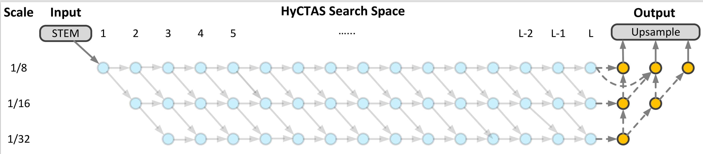
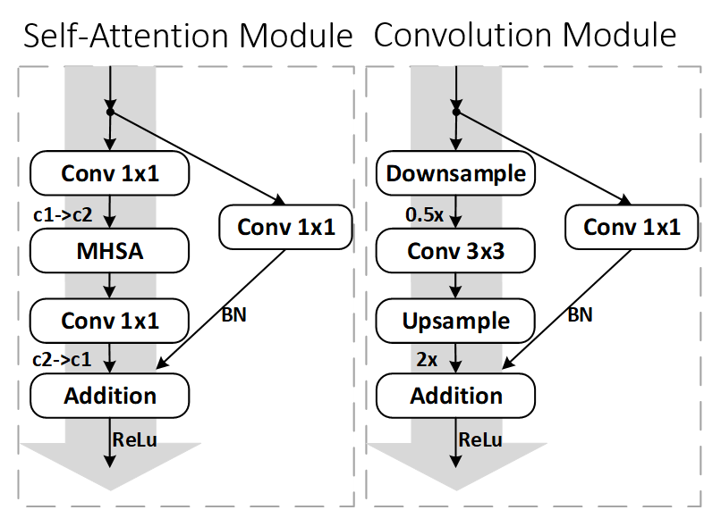
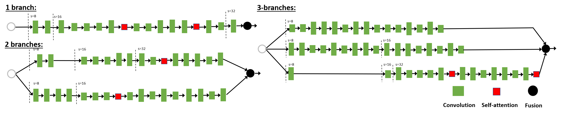

# HyCTAS: Real-Time Image Segmentation via Hybrid Convolutional-Transformer Architecture Search

<div align="center">

<h2><a href="https://arxiv.org/abs/2403.10413">Real-Time Image Segmentation via Hybrid Convolutional-Transformer Architecture Search</a></h2>

[Hongyuan Yu](https://hongyuanyu.github.io/), [Cheng Wan](https://jornywan.github.io/), [Mengchen Liu](https://scholar.google.com/citations?user=cOPQtYgAAAAJ&hl=zh-CN), [Dongdong Chen](https://scholar.google.com/citations?user=sYKpKqEAAAAJ&hl=en&oi=ao), [Bin Xiao](https://scholar.google.com/citations?user=t5HZdzoAAAAJ&hl=en&oi=ao) and [Xiyang Dai](https://scholar.google.com/citations?user=QC8RwcoAAAAJ&hl=en&oi=ao)

[](https://arxiv.org/abs/2403.10413)

</div>

## Overview

We develop a multi-target multi-branch supernet method, which not only retains the
multi-branch structure of HRNet, but also finds the proper location for placing multi-head self-attention module. Our search algorithm is optimized towards multiple objectives (e.g., latency and mIoU) and capable of finding architectures on Pareto frontier with arbitrary number of branches in a single search. We further present a series of HyCTAS that searched for the best hybrid combination of light-weight convolution layers and memory-efficient self-attention layers between branches from different resolutions and fuse to high resolution for both efficiency and effectiveness.

<p align="center">
  </br>
  <span align="center">HyCTAS search space</span>
</p>

<p align="center">
  </br>
  <span align="center">HyCTAS searchable modules</span>
</p>


Highlights:
* **1**: We design a novel searching framework incorporating with multi-branch space for high resolution representation and genetic-based multi-objective.
* **2**: We present a series of HyCTAS that combines a light-weight convolution module to reduce the computation cost while preserving high-resolution information and a memory efficient self-attention module to attend long-range dependencies.
* **3**: HyCTAS achieves extremely fast speed, low flops, low parameters and maintains competitive accuracy.

## Results
<p align="center">
  </br>
  <span align="center">HyCTAS models</span>
</p>


## Prerequisites
- Ubuntu 16.04
- Python 3.7
- CUDA 10.2 (lower versions may work but were not tested)
- NVIDIA GPU (>= 11G graphic memory) + CuDNN v7.3

This repository has been tested on GTX 2080Ti. Configurations (e.g batch size, image patch size) may need to be changed on different platforms.

## Installation
* Clone this repo:
```bash
git clone https://github.com/HyCTAS/HyCTAS.git
cd HyCTAS
```
* Install dependencies:
```bash
bash install.sh
```

## Usage
### 0. Prepare the dataset
* Download the [leftImg8bit_trainvaltest.zip](https://www.cityscapes-dataset.com/file-handling/?packageID=3) and [gtFine_trainvaltest.zip](https://www.cityscapes-dataset.com/file-handling/?packageID=1) from the Cityscapes.
* Prepare the annotations by using the [createTrainIdLabelImgs.py](https://github.com/mcordts/cityscapesScripts/blob/master/cityscapesscripts/preparation/createTrainIdLabelImgs.py).
* Put the [file of image list](tools/datasets/cityscapes/) into where you save the dataset.


### 1. Search

#### 1.1 Pretrain the supernet
Before architecture search, pretrain the multi-branch supernet to obtain shared weights, enabling fast proxy evaluation of candidate mIoU and latency.

- Change to the search directory:
```bash
cd search
```

- Configure dataset path and key training/search parameters:
  - Set `C.dataset_path` in [search/config_search.py](search/config_search.py:29) to the Cityscapes root, and ensure `train_source`/`eval_source` point to the correct file lists.
  - Common knobs (tune per hardware/budget):
    - [search/config_search.py](search/config_search.py:86) `C.Fch` (filter multiplier / base channels)
    - [search/config_search.py](search/config_search.py:88) `C.width_mult_list` (available width ratios)
    - [search/config_search.py](search/config_search.py:102) `C.image_height` and [search/config_search.py](search/config_search.py:103) `C.image_width` (train/eval input size)
    - [search/config_search.py](search/config_search.py:104) `C.nepochs` (epochs)
    - [search/config_search.py](search/config_search.py:96) `C.batch_size` (batch size)

- Launch supernet pretraining (example; adjust epochs/bs/save as needed):
```bash
CUDA_VISIBLE_DEVICES=0 python train_search.py --epochs 120 --bs 4 --save ep120_sk50_jp40_bs4
```

- Outputs:
  - Logs and sampled architectures: `../OUTPUT/ep120_sk50_jp40_bs4/`
  - Shared weights: `../OUTPUT/ep120_sk50_jp40_bs4/weights.pth.tar` (pass via `--resume` during search)

Notes:
- The script randomly samples 1/2/3-branch subnets per step to balance multi-branch coverage; OHEM loss and AMP mixed precision are enabled in [search/train_search.py](search/train_search.py:260).
- If memory is tight, reduce [search/config_search.py](search/config_search.py:96) `C.batch_size` or the input size.

#### 1.2 Multi-objective architecture search per branch count (EA/NSGA-II)
With the supernet trained, run evolutionary search separately for 1-, 2-, and 3-branch spaces. Optimize mIoU jointly with a secondary objective (latency/FLOPs/params) to obtain an approximate non-dominated set (approximate Pareto front).

- 1-branch search (latency-focused example):
```bash
CUDA_VISIBLE_DEVICES=0 python ea_pymoo1path.py \
  --resume ../OUTPUT/ep120_sk50_jp40_bs4/weights.pth.tar \
  --save_dir ./search_1path_latency \
  --target 0
```

- 2-branch search (latency-focused example):
```bash
CUDA_VISIBLE_DEVICES=0 python ea_pymoo2path.py \
  --resume ../OUTPUT/ep120_sk50_jp40_bs4/weights.pth.tar \
  --save_dir ./search_2path_latency \
  --target 0
```

- 3-branch search (latency-focused example):
```bash
CUDA_VISIBLE_DEVICES=0 python ea_pymoo3path.py \
  --resume ../OUTPUT/ep120_sk50_jp40_bs4/weights.pth.tar \
  --save_dir ./search_3path_latency \
  --target 0
```

Parameters:
- `--resume` points to the shared supernet weights from step 1 (`weights.pth.tar`).
- `--save_dir` is the output folder where `N.json` candidate files are written (each contains ops/paths/downs/widths/lasts and mIoU, latency, FLOPs, params).
- `--target` chooses the secondary objective paired with mIoU:
  - `0` latency (default; mIoU↑ and latency↓)
  - `1` FLOPs (mIoU↑ and FLOPs↓)
  - `2` params (mIoU↑ and Params↓)

Details & constraints:
- BN statistics are recalibrated before evaluation to stabilize proxy estimates; see `set_bn` in [search/ea_pymoo1path.py](search/ea_pymoo1path.py:382) and [search/ea_pymoo2path.py](search/ea_pymoo2path.py:389).
- Latency range filtering: each script sets `fps_low`/`fps_high`; candidates out of range are dropped to speed up search.
- Topology constraints include distinct down-sample locations across branches, forbidding skip at down-sample positions, and ensuring the last layer is not a down-sample; see validity checks.
- Use the corresponding `ea_pymoo{1,2,3}path.py` per branch count; together they cover different budgets as an approximate non-dominated set.

After search:
- Select candidates from `save_dir` that meet deployment budgets (e.g., latency cap/parameter limit). Use the architecture description for downstream training-from-scratch and export.
### 2. Train from scratch
* `cd HyCTAS/train`
* Set the dataset path via  `ln -s $YOUR_DATA_PATH ../DATASET`
* Set the output path via `mkdir ../OUTPUT`
* Train from scratch
```
export DETECTRON2_DATASETS="$Your_DATA_PATH"
NGPUS=8
python -m torch.distributed.launch --nproc_per_node=$NGPUS train.py --world_size $NGPUS --seed 12367 --config ../configs/cityscapes/semantic.yaml
```

### 3. Evaluation
We provide training models and logs, which can be downloaded from [Google Drive](https://drive.google.com/drive/folders/10jR2H5JwuJq9UuPGWutyw50MHESBZZ3w?usp=sharing).

```bash
cd train
```
* Download the pretrained weights of the from [Google Drive](https://drive.google.com/drive/folders/10jR2H5JwuJq9UuPGWutyw50MHESBZZ3w?usp=sharing).
* Set `config.model_path = $YOUR_MODEL_PATH` in `semantic.yaml`.
* Set `config.json_file = $HyCTAS_MODEL` in `semantic.yaml`.
* Start the evaluation process:
```bash
CUDA_VISIBLE_DEVICES=0 python test.py
```

## Cite

If you find this repository useful, please use the following BibTeX for citation.

```latex
@misc{yu2024realtime,
      title={Real-Time Image Segmentation via Hybrid Convolutional-Transformer Architecture Search}, 
      author={Hongyuan Yu and Cheng Wan and Mengchen Liu and Dongdong Chen and Bin Xiao and Xiyang Dai},
      year={2024},
      eprint={2403.10413},
      archivePrefix={arXiv},
      primaryClass={cs.CV}
}
```
